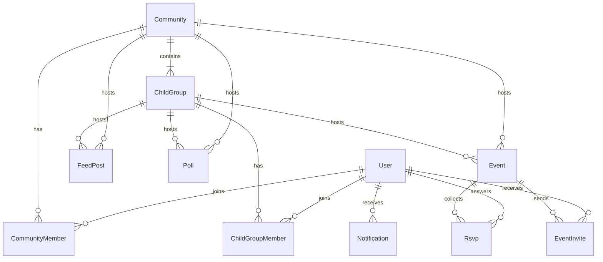

# Communities

Living source of truth for community scope and status. Update the checklist in this file when work starts or lands.

## Current baseline

What the app already does, and what this feature must not pretend is there.

| Area | Today |
| --- | --- |
| Users | JWT auth. `users.isAdmin` is a site-admin flag and does not grant a community role. Community roles live on `community_members`. |
| Events | Every event is public. `GET /api/events` and `GET /api/events/:id` have no audience filter. An event already has `locationName`, coordinates, `startDate`, and `endDate`. List (`/events`), map (`/map`), and calendar (`/calendar`) all read that public set. |
| Posts | `posts` is the public news CMS (`/news`). Community posts are a new table, `community_posts`. |
| Social | No comments, polls, RSVP, or notification inbox. |
| Images | Sharp variants for `events`, `series`, `posts`, `community-heroes`, and `community-logos`. Private community images and invite-only subgroup images need a signed `access` query and are not publicly cached. |
| Mail | Resend sends password reset and OTP. Budget is 3000 mails/month, so email is not the fan-out channel. |

An event with no community host stays a public calendar event. Members-only listing requires a host.

## Domain

A post, poll, or event has one host: the community itself, or exactly one subgroup. Never both, never neither for those three objects once they are community content. Membership is two tables so a subgroup role cannot be stored as a community role.

`ChildGroup` in the diagram is a subgroup. The node is not named `subgroup` because that word breaks Mermaid.

`FeedPost` is the `community_posts` table. It is not a row in `posts`.

## Roles

| Table | Role | Rule |
| --- | --- | --- |
| `CommunityMember` | `member` or `admin` | A community always has at least one admin. The last admin cannot leave, be removed, or be demoted until another admin exists. |
| `ChildGroupMember` | `member` or `moderator` | A subgroup may have zero moderators. Community admins can manage every subgroup without a moderator row. |

- A subgroup member is always a community member. Removing someone from the community removes them from its subgroups.
- Only community admins appoint or remove admins and moderators. A moderator cannot grant either role.
- `users.isAdmin` does not grant a community role.

### Moderator, inside their subgroup only

- Edit subgroup name, description, hero, and logo.
- Approve or reject subgroup join requests, and invite people into an invite-only subgroup.
- Create and moderate subgroup posts, comments, and polls.
- Create subgroup events, see RSVPs, and send event invitations.

A moderator cannot change community settings, community visibility, other subgroups, or community membership.

Community admins moderate the community feed and every subgroup. They do not need a moderator row to do that.

## Visibility

| Object | Values | Meaning |
| --- | --- | --- |
| Community | `public` | Listed. Instant join. |
| Community | `request` | Listed. Join waits for admin approval. |
| Community | `private` | Unlisted. Invite only. |
| Subgroup | `open` | Any community member joins immediately. |
| Subgroup | `request` | Community member requests; a moderator or community admin approves. |
| Subgroup | `invite` | Hidden from non-members. Invite only. |
| Event listing | `members` | Hidden from `/events`, `/map`, `/calendar`, and direct fetch by outsiders. |
| Event listing | `public` | Normal discovery on the existing list, map, and calendar. |

- RSVP count is visible to anyone who can see the event.
- Event comments are limited to members of the host.
- Meetup place, time, and note are optional and separate from `startDate` and `locationName`.
- A public community event still needs a discipline so it fits the existing list, map, and filters.

## Notifications

Decision, recorded here:

- The in-app inbox is the product. New events in your communities, event invites, join requests, and request decisions write a row there.
- Email only for a direct event invitation, and only if the user has `emailVerified`. No mail because an event was created.
- Invitation mail has a hard cap so the 3000/month Resend budget still covers password reset and OTP. Auth mail stays untouched.

## Tracker

Status values: `todo`, `doing`, `done`, `later`, `blocked`. Ids stay stable; do not renumber when a row is added.

### 1. Foundations

| Id | Status | Note |
| --- | --- | --- |
| `community-crud` | done | Create, read, and update a community (name, description, visibility). Slug stays stable after create. |
| `community-media` | done | Hero and logo via Sharp. Upload subjects `community-heroes` and `community-logos`. |
| `community-membership` | done | `community_members` with role `member` or `admin`. |
| `admin-invariant` | done | Last admin cannot leave, be removed, or be demoted. Row lock plus `isLastAdminRemoval`. |
| `community-visibility` | done | `public`, `request`, and `private`. Private lookup is 404 for non-members, including id routes. |
| `my-communities` | done | `GET /api/communities/mine` and the Mine section on `/communities`. |

### 2. Subgroups, moderators, people

| Id | Status | Note |
| --- | --- | --- |
| `subgroup-membership` | done | Separate subgroup membership. Leaving a community deletes that user's subgroup rows. |
| `subgroup-visibility` | done | `open`, `request`, and `invite`. Invite-only subgroups 404 for outsiders. |
| `moderator-role` | done | `member` or `moderator`. Zero moderators allowed. Community admins manage every subgroup without a moderator row. |
| `moderator-permissions` | done | Moderators edit name, description, hero, logo, requests, and invites. Visibility and member removal stay with community admins. |
| `member-pages` | done | Member lists for a community and for a subgroup. |
| `join-requests` | done | Community and subgroup request queues: list, approve, reject. |
| `membership-invites` | done | Admins invite by email into a community. Admins and moderators invite community members into a subgroup. |

### 3. Posts and comments

| Id | Status | Note |
| --- | --- | --- |
| `community-posts` | todo | `community_posts`, member-only, one host. Editorial `posts` stay the public news CMS. |
| `post-comments` | todo | Comments on community posts, member-only, same host audience. |
| `post-moderation` | todo | Moderators moderate their subgroup; community admins moderate the community and every subgroup. |

### 4. Polls

| Id | Status | Note |
| --- | --- | --- |
| `polls` | todo | Single or multi choice, one host, members of that host. |
| `poll-results` | todo | Results visible to members, or to admins and moderators only. |
| `poll-deadline` | todo | Poll closes at a deadline. |

### 5. Events

| Id | Status | Note |
| --- | --- | --- |
| `event-host` | todo | One host on `events`: the community or exactly one subgroup. Unhosted events stay public calendar rows. |
| `event-listing` | todo | Listing `members` or `public`. A public community event still requires a discipline. |
| `members-event-hide` | todo | `members` events stay off `/events`, `/map`, `/calendar`, and direct fetch by outsiders. |
| `rsvp` | todo | RSVP plus a count visible to anyone who can see the event. |
| `event-comments` | todo | Event comments limited to members of the host. |
| `meetup-fields` | todo | Optional meetup place, time, and note, separate from `startDate` and `locationName`. |
| `event-create-flow` | todo | Create an event from a community or a subgroup. |

### 6. Invites and inbox

| Id | Status | Note |
| --- | --- | --- |
| `event-invite` | todo | Per-member event invite, distinct from “an event exists”. |
| `notification-inbox` | todo | In-app rows for new community events, event invites, join requests, and request decisions. |
| `invite-email` | todo | Email only a direct event invitation to a verified address, under a hard cap that leaves room for auth mail. |

## Regression

`members-event-hide` is the gate for discovery. A members-only event must never appear in unauthenticated `GET /api/events`, the map, or the calendar, including direct id access (`GET /api/events/:id` and `/events/:id`).

## Out of scope

Payments, chat, recurring series, and push notifications.
